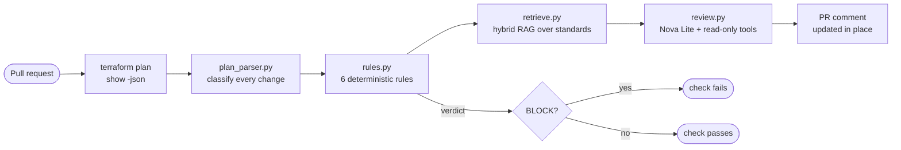

# bedrock-terraform-reviewer

**An AI reviewer for Terraform pull requests, built on Amazon Bedrock, where deterministic rules make the safety decision and the model only explains it.**

Every pull request to [terraform-aws-portfolio](https://github.com/YoungMaster009/terraform-aws-portfolio) gets a review comment: a pass/fail verdict from tested Python rules, each finding linked to a team standard, and a plain-English explanation written by Amazon Nova Lite, grounded in those standards. A full review costs about **$0.0002**.

> **Design principle:** I don't let the LLM make the safety decision. Rules decide; the model explains; if the model fails, the review still posts.

## What a review looks like

```text
## ❌ Terraform plan review: FAIL

| Severity | Rule                     | Resource                                  | Finding                          | Standard   |
|----------|--------------------------|-------------------------------------------|----------------------------------|------------|
| BLOCK    | ADMIN_PORT_OPEN_TO_WORLD | module.compute.aws_security_group.servers | SSH (port 22) is open to 0.0.0.0/0 | STD-NET-01 |

### AI explanation (advisory only)
- Why it matters: Open admin ports are scanned and brute-forced within minutes of going live.
- Suggestion: Use AWS Systems Manager Session Manager for shell access, or limit the source to a known private range.
- See STD-NET-01

model: us.amazon.nova-lite-v1:0, tool_calls: 1, retrieval: embedding, input_tokens: 2273, output_tokens: 232
```

## How it works



1. **Parse.** `terraform show -json` is turned into a list of changes: create, update, delete, or replace (including `create_before_destroy`), with the attribute that forced each replacement.
2. **Decide (deterministic).** Six rules produce findings. Any `BLOCK` fails the check.
3. **Retrieve (hybrid RAG).** Each rule maps directly to the standard it enforces; Cohere Embed v4 finds other relevant standards from `standards.md`, with a keyword fallback if embeddings are unavailable.
4. **Explain (bounded agent).** Nova Lite receives an outline and calls two read-only tools, `get_change` and `lookup_standard`, for the details it needs, then returns structured JSON.
5. **Post.** One PR comment, updated on every push. The check then enforces the rules' verdict.

## The rules

| Rule | Severity | Fires when |
|---|---|---|
| `STATEFUL_DESTROY` | BLOCK | A database, bucket, table, volume, KMS key, or secret is deleted or replaced |
| `REPLACE` | WARN | Any other resource is replaced; names the attribute that forced it |
| `ADMIN_PORT_OPEN_TO_WORLD` | BLOCK | SSH or RDP open to `0.0.0.0/0` or `::/0`, including port ranges and protocol `-1`, across all three Terraform ingress styles |
| `IAM_WILDCARD` | BLOCK / WARN | `Action "*"` on `Resource "*"`, an AdministratorAccess attachment, or whole-service wildcards |
| `IAM_POLICY_UNKNOWN` | WARN | A policy is only known after apply, so it can't be checked; never a silent pass |
| `S3_PUBLIC` | BLOCK | Block Public Access turned off, a public ACL, or a bucket policy open to `"*"` without a condition |

## Guardrails

| Guardrail | How it's enforced |
|---|---|
| The verdict never comes from the model | Rules run first; a test proves an "approve it, it's safe" model reply can't change a FAIL |
| No secrets or values reach the model | The model sees attribute *names* only; tested with a password-change fixture |
| Prompt injection | Injected text in tags and descriptions never reaches the model (architecture, not prompt wording); an injected resource *name* is an eval case |
| No hallucinated resources or citations | Explanations about unknown addresses and citations of unknown standards are dropped |
| The agent loop always ends | At most 4 model turns and 6 tool calls; tools are read-only Python, never AWS |
| AI failure never blocks a review | Any Bedrock error falls back to the rules-only comment |
| Least-privilege IAM, re-proven on every PR | The role can call two models only through their US inference profiles; CI confirms Nova Pro, the global profile, and direct model calls get `AccessDenied` |
| Keyless CI | GitHub OIDC with trust pinned to the repository's immutable owner and repo IDs, pull requests only |

## Evaluation

`evals/run_evals.py` scores 10 cases with known answers, including a prompt-injection case, a secret-in-values case, and a regression case for a real hallucination found during development. Latest run ([report](evals/report.md)):

| Metric | Result |
|---|---|
| Deterministic checks (verdict, findings) | **10/10** |
| AI checks (citation, required and forbidden phrases) | **10/10** |
| Related-standard precision | **100%** (3/3), up from 30% after tuning |
| Cost of the full eval run | **$0.0019** |

Plus **82 unit tests** that run on every push with no AWS access, using a fake Bedrock client.

## What went wrong, and what I learned

| Symptom | Cause | Fix |
|---|---|---|
| The model said a policy "allows wildcard permissions" when the rule said it couldn't be checked | The model trusted the rule's *label* (`IAM_WILDCARD`) over its message | Gave the case its own rule ID, added a prompt rule, and made it a permanent eval case |
| `ThrottlingException` on the very first embedding call | Titan Embeddings' on-demand quota in this account is **0** and not adjustable, in every Region checked | Noticed cross-Region quotas were nonzero (which also explained why Nova Lite always worked) and routed embeddings through Cohere's US inference profile |
| IAM policy simulator returned `implicitDeny` for the allowed model | The simulator can't evaluate Bedrock inference-profile ARNs (it showed a placeholder ARN) | Treated it as inconclusive and proved the policy with live allowed and denied calls instead |
| Related standards were mostly irrelevant | Measured 30% precision; scores for short queries clustered between 0.31 and 0.46 | Raised the cutoff to 0.45 based on the eval data; precision 100%, with lower recall as a known trade-off |
| `requirements.txt` showed as garbled on GitHub | Windows PowerShell's `>` writes UTF-16 | Set the encoding explicitly and added `.gitattributes` on day one |
| Git refused the repo: "dubious ownership" | The folder was created from an elevated shell | Trusted that one path with `safe.directory`, never `*` |

## Costs

| Item | Cost |
|---|---|
| One PR review (Nova Lite, about 2–4K tokens in, with tools) | ~$0.0002–0.0003 |
| One query embedding (Cohere Embed v4) | fractions of a cent |
| Indexing all 14 standards | one request, cached in `standards_index.json` |
| Infrastructure that bills by the hour | none |

## Repository layout

```text
plan_parser.py        terraform show -json -> list of classified changes
rules.py              the six deterministic safety rules (the verdict)
retrieve.py           hybrid RAG: rule mapping + Cohere embeddings + keyword fallback
tools.py              read-only tools for the agent: get_change, lookup_standard
review.py             the bounded agent loop and the PR comment
standards.md          14 team standards, each with Rule, Why, and Fix
standards_index.json  cached standard embeddings (rebuilt if standards.md changes)
evals/                cases with known answers, the runner, and the latest report
security/             live least-privilege proof that runs in CI
tests/                82 unit tests and 11 fixture plans
infra/main.tf         the reviewer's IAM role (OIDC trust, two models, profiles only)
```

## Run it locally

```powershell
python -m venv .venv; .venv\Scripts\Activate.ps1
pip install -r requirements.txt
python -m pytest -q                                          # 82 tests, no AWS
python review.py tests\fixtures\sg_ssh_open_to_world.json --no-ai   # rules only
python review.py tests\fixtures\sg_ssh_open_to_world.json           # with Bedrock
python evals\run_evals.py                                    # full eval, about $0.002
```

## Limitations and next steps

- **Retrieval recall.** The 0.45 cutoff keeps precision at 100% but shows related standards on only 2 of 10 cases. Next: richer retrieval queries built from finding messages and changed attribute names.
- **Unknown-at-plan policies.** Policies referencing resources created in the same apply can't be checked; planning against an existing environment closes the gap.
- **Pinning.** Pin the reviewer checkout and GitHub Actions to commit SHAs for supply-chain safety.
- **Model comparison.** Run the eval set against a larger model to measure whether its quality gain justifies the cost.

## Related projects

- [terraform-aws-portfolio](https://github.com/YoungMaster009/terraform-aws-portfolio): the multi-environment AWS stack this reviewer guards.
- [k8s-aws-portfolio](https://github.com/YoungMaster009/k8s-aws-portfolio): a containerized app on Amazon EKS with one-click deploy and teardown.
